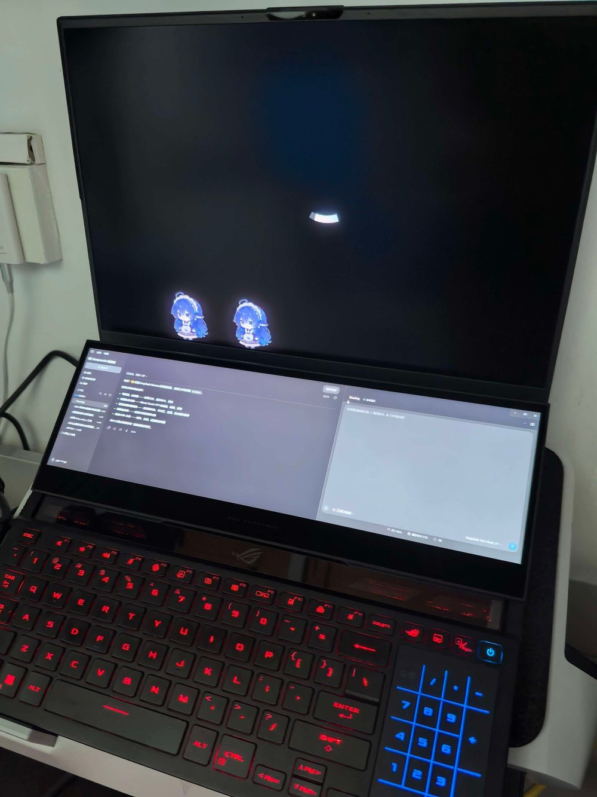
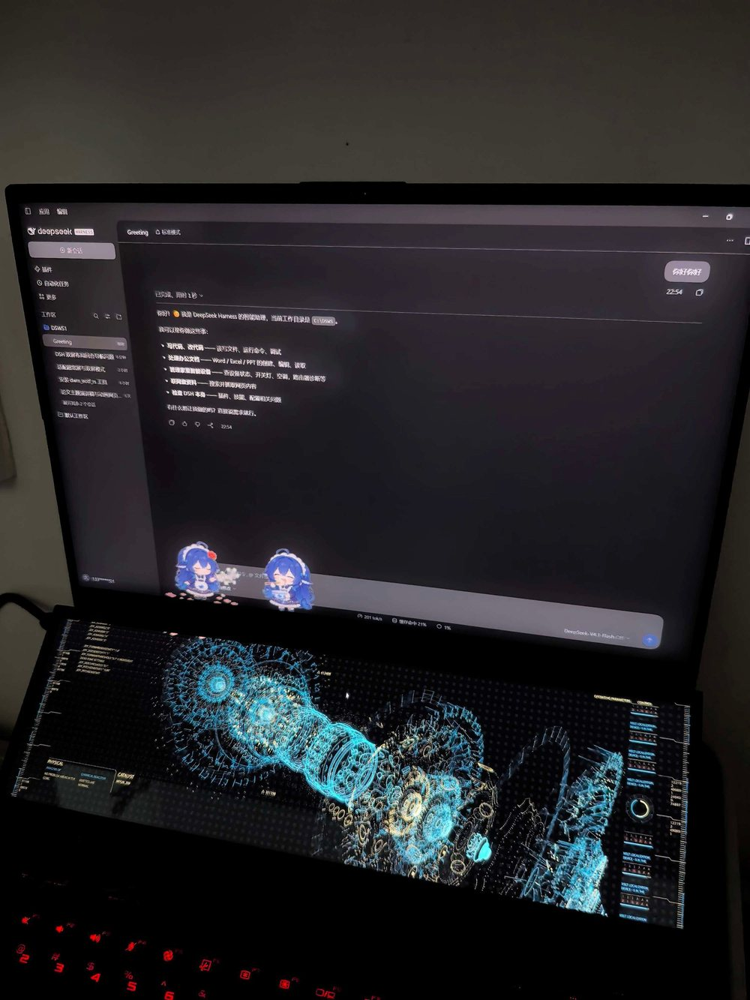
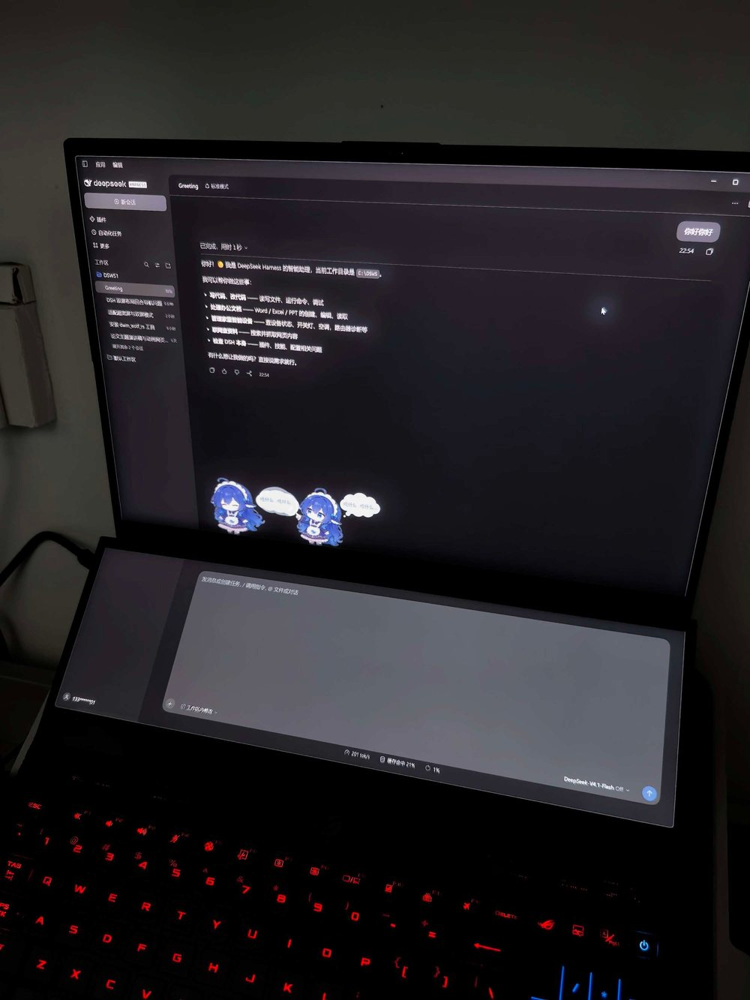

# 华硕duo系列窗口优化

一个 **DeepSeek Harness (DSH) Web GUI** 的客户端布局插件：把对话区和输入框重新排布到长条 / 超宽窗口里。只覆盖布局，不改 DSH 源码，不新增面板。

**不只冰刃7。** 这些窗口都能用：

- 华硕 Duo 系列笔记本（冰刃7 / ROG Zephyrus Duo 等）；
- 带鱼屏 / 超宽屏（21:9、32:9，例如 3440×1440、3840×1100、5120×1440）；
- 其他“特别宽、特别矮”或“上下很高、左右很窄”的窗口。

## 效果图

实机效果（ROG Zephyrus Duo / 冰刃7）：

| 实机 1 | 实机 2 | 实机 3 |
|---|---|---|
|  |  |  |

## 三种形态

| 形态 | 触发 | 布局 |
|---|---|---|
| 自动适配 | 按窗口宽高比 | ≥ 2.2 → 右输左出；0.85–1.18 → 上下分栏；其他默认 |
| 默认 | 手动 / 其他 | 原生布局，零覆盖 |
| 右输左出 | 自动（带鱼屏 / 超宽屏）或手动 | 左对话、右输入，输入列从顶端占满全高 |
| 上下分栏 | 自动（窗口**物理高度 > 2000px**，即真正跨到第二块屏）或手动 | 上半对话；底部 734 物理像素输入带；右侧栏只到输入带上沿 |

21:9 带鱼屏（3440×1440 ≈ 2.39）也会自动进入右输左出；32:9 更长屏同样。比例特殊时，可在 **设置 → 插件 → 华硕duo系列窗口优化 → 布局** 里手动固定。

上下分栏里打开原图预览时，图片只在上方 **1600 物理像素**内居中，不会压到输入带；输入 `@` 或 `/` 的候选菜单也整体停在这 1600 像素以内，不会伸进输入带。

右输左出（超宽屏）里，输入 `@` 或 `/` 弹出的候选菜单会浮在**对话区**上方，而不是挤在右侧窄输入列里；菜单宽度跟着对话区走，最高 420px。双屏输入窗里同一菜单落在输入卡第一行下面，不挡已输入的文字，也不会盖住底部工具栏。

## 峰 / 谷时段提示与确认

- 鼠标悬停在输入框右侧的圆形发送按钮上，提示显示 **发送消息（峰）** 或 **发送消息（谷）**：峰字红色、谷字绿色。忙时按钮显示「排队发送」，后缀一样跟着变。
- **峰时段**：北京时间周一至周五（不含中国法定节假日）**09:00–12:00、14:00–18:00**；其余时段——含午休、夜间、周末和法定节假日全天——都是**谷时段**。谷时段价格是峰时段的一半。
- 法定节假日按国务院通知内置：2026 年（国办发明电〔2025〕7号）与 2027 年（国办发明电〔2026〕10号）；调休上班的周末仍按周末算谷时。
- **峰时段**里，本次启动的**第一次发送**会先弹二次确认：标题「峰时段发送」，正文「现在是**峰**时段，距离下一个谷时段还有 `hh:mm:ss`」（每秒刷新），按钮「取消 / 发送」。
- 只有点「发送」才算这次提示失效；点「取消」不算，下次发送还会弹。
- 谷时段发送不算数：先发过谷时消息、之后进入峰时段再发，仍然会弹出这次确认。
- 「每次启动一次」的标志存在会话存储里：刷新页面不重置，**重启客户端后重置**。
- 副屏里 `@` / `/` 的候选列表会撑满输入框：从**实际的第一行文字下面**（挂了图片/文件附件时自动下移，不再压住打字位置）一直排到工具栏上方（按窗口高度算，约 249px@489 高窗口、471px@711 高窗口），不用再滚一个小窗口；
- 空白会话（新对话）里，输入框所在的那一列还会带「探索未至之境」大标题和工作区行，会把输入框顶出窗口；副屏形态把这两块藏掉，只留输入卡片，卡片因此完整落在窗口内；
- 副窗刚打开的前 4 秒用 20ms 一轮的快轮询（之后回到推送/8 秒兜底），保证一开机就立刻对齐主窗的会话；
- 副屏输入框的上下留白最多 72px（左右留白在超宽窗口下会到 200–300px，按它做上下留白会把输入框压扁）；卡片高度 = 窗口高 − 2×72，写很多行时在输入区内部滚动，不会把上下边框顶出屏幕。

## 双屏协同

点标题栏 **「双屏」**，或走 **设置 → 插件 → 华硕duo系列窗口优化 → 双屏协同 →「打开副屏输入窗」**：

1. **两个窗口各占一块屏**：点「双屏」后主窗自动挪到 1 号屏并最大化，输入窗在 2 号屏最大化——不用手动拖窗口；
2. **进入双屏时自动收起主窗左侧边栏**：走的是宿主自己的收起动作（不是只用 CSS 藏起来），所以对话真的从窗口左边缘开始，不会留下侧栏那一列和它的接缝边框；**退出双屏时再自动展开回来**（如果进双屏前你自己就是收起的，则不动）；
3. **主窗只留上下文和右侧边栏**：输入框隐藏，对话占满让出的宽度，右侧边栏（文件 / 终端 / 浏览器抽屉）保持原来的宽度和开关状态；分隔线跟着实际列宽走，拖动到头也不会在对话和面板之间留空白条；
4. **副屏只留左侧边栏和输入框**：对话正文、会话标题行和页签隐藏，输入框撑满右侧空白区（上下留白最多 72px，左右留白在超宽窗口下会更大），`+` / 权限 / 模型 / 三处状态行及其展开菜单全是原版组件；窗口打开后光标直接在输入框里；
5. 两边是**同一个会话**：副窗侧栏切会话，主窗跟着切（Host 通过 SSE 推送，实测点击到主窗落地 0.1–0.2 秒；副窗刚打开的前 4 秒走 20ms 快轮询，之后靠推送 + 8 秒兜底）；副窗发送、换模型、改权限都作用于这一份会话。主窗是唯一会话所有者，副窗只是它的输入视图，副窗启动时那个空白新会话不会顶掉主窗的会话；
6. 再点一次「双屏」或直接关副窗即结束（关副窗由 Host 推送状态，不轮询）；主窗回到自动形态，左侧边栏恢复、右侧边栏保持不动。

**挑屏幕**：**设置 → 插件 → 华硕duo系列窗口优化 → 屏幕** 里可以分别选「主窗屏幕」和「输入窗屏幕」（自动列出本机所有显示器，带分辨率和主屏标记）；不选就是“主窗去主屏、输入窗去另一块屏”。改完下次点「双屏」生效。

要求：本机有 Electron 运行时。默认使用 `%USERPROFILE%\.dsh\electron\electron.exe`（dsh-pet 安装后会在那里提供，Electron 43.3+）；也可以用 `DSH_DS_ELECTRON_PATH` 指向自己的 `electron.exe`。没有 Electron 时按钮会提示打开失败，主窗布局不受影响。

副窗加载真实 DSH Web GUI 的 `?dshds=prompt` 视图（所以 UI 和按钮展开不需要仿制），会话通过 Host 的 `/dsh-ds-window/session` 同步，状态变化再由 Host 的 SSE（`/dsh-ds-window/events`）推回两个窗口：每次发布带 `source`（flow / prompt）和递增 `seq`，主窗只跟随副窗发布的会话，副窗只跟随主窗发布的会话，两边都不会把自己的回声当成指令；不存在两个独立会话。副窗关闭时 Host 推一条 `status` 事件，主窗立刻退出双屏，不需要轮询。

> 升级提示：Host 半边（`index.js`）改动只有重启 DSH 后生效。只换客户端时双屏仍能打开和同步会话，但「副窗切会话 → 主窗跟随」要等重启后的新 Host。

## 安装

需要带插件管理器的 DSH Desktop / Web GUI。

1. 在 DSH 的「设置 → 插件」里安装这个 bundle：
   - 仓库地址：`github:plane0323/asus-duo-window`
   - 或从 [Releases](https://github.com/plane0323/asus-duo-window/releases) 下载 `asus-duo-window-1.6.14.zip`，解压到本地后安装；
2. 启用 `dsh-dualscreen` bundle；
3. 重启 DSH（bundle / Host 改动需要重启；之后客户端布局会热重载）。

手动方式：把包加入 profile 的 `dependencies`（`"dsh-dualscreen": "link:<解压目录>"` 或 `"github:plane0323/asus-duo-window"`），并把 `dsh-dualscreen` 加进 `dsh.profile.bundles`，重启。

安装后「设置 → 插件」会显示「华硕duo系列窗口优化」和图标。

## 兼容性与限制

- 只改布局：默认形态完全不动，颜色 / 圆角 / 字体沿用 DSH 主题。
- 主窗布局不改变窗口数量；「双窗口（实验）」会另起一个原生输入窗（需要 Electron 运行时）。
- 自动阈值按**宽高比**，不按绝对像素；系统缩放 125% / 150% / 200% 不影响判定。
- 已在 2560×1600 + 2560×734（150% / 100%）、3840×1100 上验证；其他长屏使用同一套比例规则。
- 图标是作者提供的 ASUS ROG 产品图；ASUS、ROG 是其各自所有者的商标。本项目是非官方社区插件，与 ASUS、DeepSeek 无关联。

## 开发

- `client.js`：全部客户端逻辑（CSS 模板 + 形态引擎 + React 覆盖层），无构建步骤。
- `index.js`：Host 半边，注册 `/dsh-ds-window` 路由、记忆当前会话（带 `source` / `seq`），并在副屏拉起 Electron helper。
- `helper/main.cjs`：独立的 Electron 输入窗口（正常窗口，不是透明宠物窗）。
- `cordis.patch.yml`：插入 `dsh-dualscreen` bundle 行（Host 需要 `inject: [connection, webServer]`）。
- 只使用文档化接缝（`data-*`、CSS 变量、结构选择器），不碰 shipped 代码，也不依赖构建后的 hashed class。
